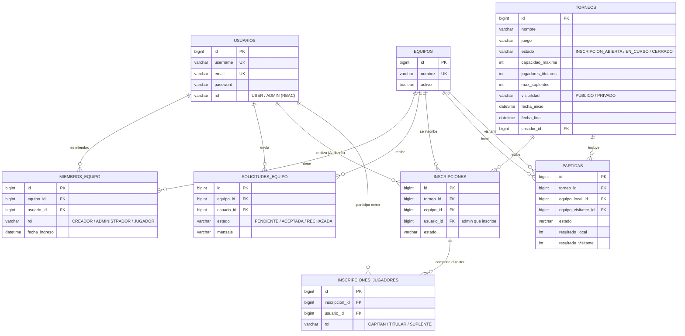

# 🪧 Aviso
El proyecto sigue en desarrollo activo. Este README se irá actualizando a medida que se completen las distintas fases del Roadmap.

# 🏆 Esports Tournament Platform - Backend API REST

Proyecto Final de Grado (2º DAW) enfocado en el desarrollo de un backend profesional, escalable y robusto para la gestión de torneos de eSports amateur. 

Más allá de ser un simple CRUD, este proyecto ha sido diseñado para poner en práctica **arquitectura limpia, optimización de consultas a base de datos y diseño orientado al dominio (DDD)**.

## 🎯 Por qué este proyecto (Para Reclutadores / Empresas)
Si estás revisando este repositorio, aquí tienes los hitos técnicos más destacados de la aplicación:
- **Optimización JPA:** Resolución del problema de consultas **N+1** mediante JPQL y `JOIN FETCH`, evitando la `MultipleBagFetchException`.
- **Arquitectura Desacoplada:** Uso estricto de **DTOs** (Request/Response) para evitar referencias circulares y fuga de datos sensibles. Los Controladores no tocan entidades de BD.
- **Manejo de Errores Global:** Implementación de `@RestControllerAdvice` para capturar excepciones de negocio (`BusinessException`) y devolver respuestas HTTP 400 semánticas y limpias.
- **Testing Unitario Profesional:** Uso de **JUnit 5 y Mockito** aplicando el patrón AAA (Arrange-Act-Assert) para tests de estado y comportamiento, aislando la lógica mediante *Mocks* e `@InjectMocks`.
- **Diseño de Base de Datos:** Resolución de relaciones N:M con entidades intermedias (`MiembroEquipo`, `JugadorInscrito`) para manejar roles granulares de dominio.

## 📌 Funcionalidades Core
 
- **Gestión de Equipos (Clubes):** Creación de equipos y gestión de roles internos (`CREADOR`, `ADMINISTRADOR`, `JUGADOR`).
- **Sistema de Solicitudes (Anti-Spam):** Flujo de peticiones de ingreso donde los usuarios aplican y solo los administradores del equipo pueden aceptar/rechazar.
- **Torneos Configurables:** Gestión de torneos con plazas máximas, fechas, capacidad del roster (titulares y suplentes) y visibilidad.
- **Inscripciones y Roster Lock:** Los equipos se inscriben, y posteriormente los administradores definen el *Roster* exacto (Alineación) que jugará el torneo asignando el rol In-Game (`TITULAR`, `SUPLENTE`).
- **Sistema Doble Ciego (Matches):** *(En desarrollo)* Reporte de resultados de partidas donde ambos capitanes envían el marcador, requiriendo coincidencia para oficializarse automáticamente.
 
## 🛠️ Stack Tecnológico
 
**Java 21** · **Spring Boot** · Spring Web MVC · Spring Data JPA / Hibernate · Jakarta Bean Validation · **PostgreSQL** · Lombok · Gradle · **JUnit 5 + Mockito**
 
## 🏗️ Arquitectura
 
Arquitectura en capas, asegurando el Principio de Responsabilidad Única (SRP):
 
```text
Controller  →  Service  →  Repository  →  PostgreSQL
(HTTP + DTOs)  (Lógica)    (Spring Data)   (Persistencia)
```
 
Decisiones de diseño:
- **Lógica de negocio en servicios**, con `@Transactional` en escrituras y `@Transactional(readOnly = true)` en lecturas para deshabilitar el *Dirty Checking* y mejorar el rendimiento.
- **Enums guardados como texto** (`EnumType.STRING`), para que la reordenación futura del código no corrompa la base de datos.
- **Reglas "Fail Fast" (Cláusulas de Guarda):** El código interrumpe su ejecución en la primera validación no cumplida, mejorando la legibilidad.
- **Cascada y `orphanRemoval`** en los agregados (`Equipo → MiembroEquipo`, `Inscripcion → JugadorInscrito`).
 
## 🗃️ Modelo de Datos
 

 
## 🔐 Reglas de Negocio Destacadas
 
Cada escritura en base de datos es atómica. Las reglas se validan centralizadamente:
 
| Operación | Reglas de Dominio |
|---|---|
| Crear Equipo | El usuario debe existir y el nombre ser único. El creador se añade automáticamente como `CREADOR`. |
| Solicitar Unirse | Validaciones Anti-Spam (no se admiten múltiples solicitudes pendientes). El usuario no puede ser ya miembro. |
| Responder Solicitud | Control de Accesos: Solo miembros con rol `CREADOR` o `ADMINISTRADOR` pueden aceptarlas. |
| Inscribir Equipo | Solo administradores del equipo. El torneo debe tener plazas y estado ABIERTO. Previene inscripciones dobles. |
| Roster Lock | Reemplaza la alineación del equipo para el torneo validando que los seleccionados pertenezcan realmente al club. |
 
*Nota sobre Seguridad:* La lógica de pertenencia (Ownership) está implementada. En la Fase 2, se integrará Spring Security + JWT para extraer de forma segura el ID del usuario del token en lugar de recibirlo en el payload.
 
## 📡 Endpoints Principales
 
| Método | Ruta | Descripción |
|---|---|---|
| `POST` | `/api/torneos` | Crea un torneo con sus configuraciones y fechas. |
| `GET` | `/api/torneos/{id}` | Devuelve un torneo optimizado (resolviendo N+1). |
| `POST` | `/api/equipos` | Crea un equipo y asigna al creador. |
| `POST` | `/api/solicitudes-equipo` | Solicita unirse a un equipo. |
| `PUT` | `/api/solicitudes-equipo/{id}/responder`| Acepta o rechaza una solicitud. |
| `POST` | `/api/inscripciones` | Inscribe un equipo en un torneo. |
| `PUT` | `/api/inscripciones/{id}/roster` | Define la alineación oficial del equipo. |
 
## 🚀 Cómo ejecutar el proyecto localmente
 
**Requisitos:** JDK 21, PostgreSQL y Git.
 
1. **Clonar el repositorio:**
```bash
   git clone <URL_DEL_REPOSITORIO>
   cd <NOMBRE_DEL_REPOSITORIO>
```
2. **Crear la base de datos** (las tablas, FKs y constraints únicas las genera Hibernate automáticamente al arrancar):
```sql
   CREATE DATABASE esports_db;
```
3. **Configurar credenciales (Variables de Entorno):** 
El proyecto utiliza un archivo oculto por seguridad. Copia la plantilla y rellénala con tus credenciales locales de PostgreSQL:
```bash
   cp .env.example .env
```
4. **Arrancar el servidor** (Usa `gradlew.bat` en Windows):
```bash
   ./gradlew bootRun
```
*(Al arrancar por primera vez, el `DataSeeder` inyectará automáticamente datos de prueba en la base de datos para facilitar las pruebas con Postman).*
 
La API quedará expuesta en `http://localhost:8080`.
 
## 🗺️ Roadmap (Próximas Fases)
 
- [ ] **Fase 2 (Seguridad):** Spring Security, BCrypt para contraseñas, Login/Registro y Autenticación Stateless con JWT.
- [ ] **Fase 3 (Lógica Deportiva):** Endpoints de partidas (Matchmaking básico, doble ciego para reportes, manejo de estado de conflicto).
- [ ] **Fase 4 (Documentación & QA):** Aumentar el Code Coverage con Mockito y documentar la API visualmente usando OpenAPI / Swagger UI.

---
**Desarrollado con ☕ por Marcos Muñoz Carrasco** - Estudiante de Desarrollo de Aplicaciones Web (DAW) buscando oportunidades de prácticas.
